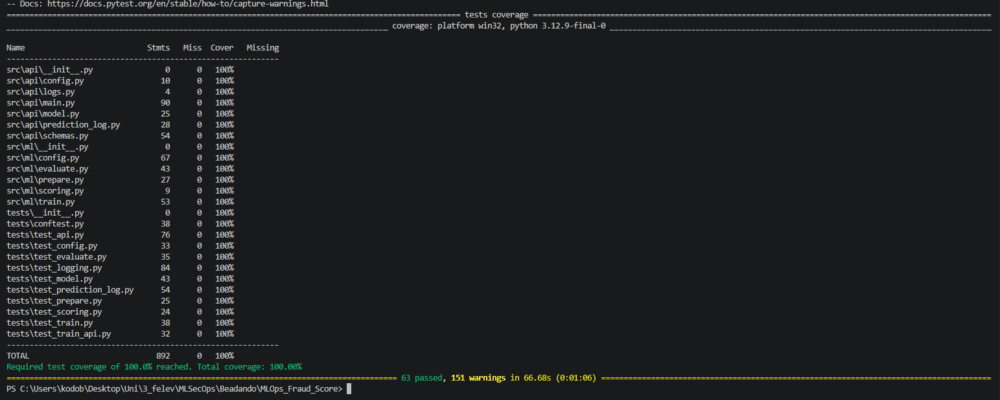
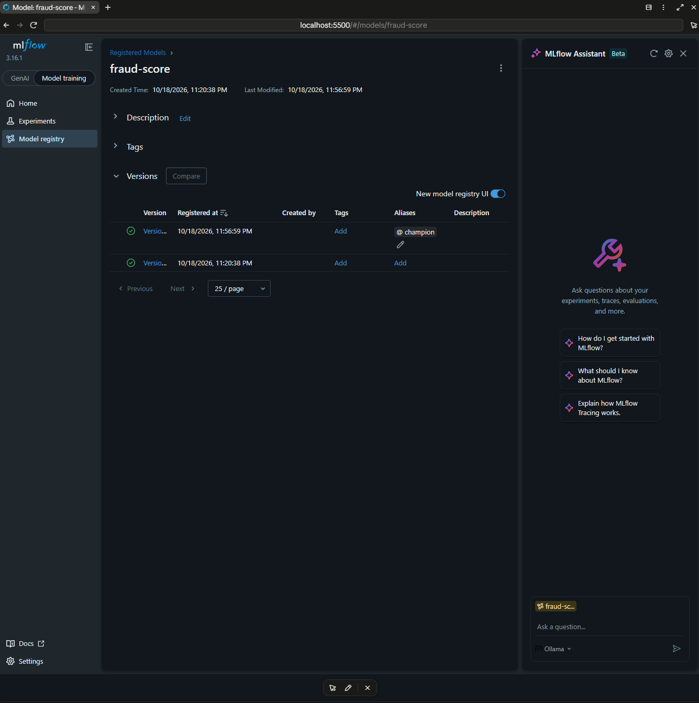
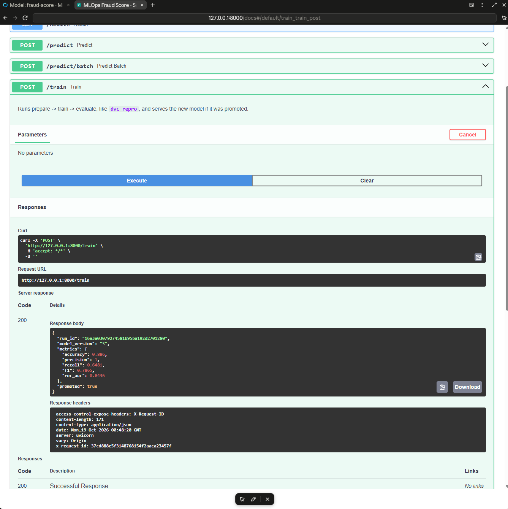

# MLOps Fraud Score

An MLOps project for scoring card transactions for fraud. It covers data versioning with DVC, a training pipeline tracked in MLflow with a model registry and an automatic quality gate, a FastAPI scoring service that serves the registry's champion model, tests with 100% coverage, flake8 and pyright checks enforced by a pre-commit hook and GitHub Actions, and a Python environment managed with [uv](https://docs.astral.sh/uv/).

## Requirements

- Python 3.12
- [uv](https://docs.astral.sh/uv/getting-started/installation/)
- Git
- [Docker Desktop](https://www.docker.com/products/docker-desktop/), for MLflow, MinIO and Postgres

## Setup

```bash
git clone git@github.com:Szelmat/MLOps_Fraud_Score.git
cd MLOps_Fraud_Score

# Create .venv and install the dependencies from pyproject.toml / uv.lock
uv sync

# Install the git pre-commit hook (once per clone)
uv run pre-commit install

# Start Postgres, MinIO, MLflow and the API (see "Infrastructure").
# docker compose fails without .env and secrets/, so copy the examples first.
cp .env.example .env
cp -r secrets_example secrets
docker compose up -d --build

# Download the data from DagsHub (needs credentials, see "DVC remote") and copy it to MinIO
uv run dvc pull -r origin
uv run dvc push
```

You don't need to activate the virtual environment. Prefix commands with `uv run`:

```bash
uv run python <script>.py
uv run dvc <command>
uv run pytest
```

To add a dependency:

```bash
uv add <package>          # runtime dependency
uv add --dev <package>    # development-only dependency (tests, linters, ...)
```

Commit both `pyproject.toml` and `uv.lock` after any change to the dependencies.

## Infrastructure

`docker-compose.yaml`, based on the course template, starts the scoring API and the services the pipeline and the API use:

| Service | Address | Purpose |
|---------|---------|---------|
| `api` | http://localhost:8000/docs | The scoring API (see "Running the API") |
| `mlflow` | http://localhost:5500 | MLflow tracking server and model registry |
| `minio` | http://localhost:9001 (console), http://localhost:9000 (S3 API) | DVC remote (`dvc` bucket) and MLflow artifacts (`mlflow` bucket) |
| `postgres` | inside the compose network | MLflow backend store |

Two one-off containers run at startup: `create-buckets` creates the two buckets, and `set-dvc-remote` adds the `dvc` bucket as the default DVC remote `storage` in `.dvc/config.local`. If `.dvc/config.local` also holds your DagsHub credentials, `set-dvc-remote` exits with code 255: its last command, `dvc remote list --local`, fails on the `origin` entry that has no URL there. The remote is set anyway.

Settings come from `.env` (copy `.env.example`) and passwords from `secrets/` (copy `secrets_example/`). Git ignores both. Log in to the MinIO console with `MINIO_ROOT_USER` and `secrets/minio_root_password.txt`.

```bash
docker compose ps       # postgres, minio, mlflow and api: healthy
docker compose stop     # stop the services, keep the data
docker compose start    # start them again
docker compose down -v  # remove the containers and all their data
```

The pipeline and the API download MLflow artifacts through the tracking server (`MLFLOW_ENABLE_PROXY_MULTIPART_DOWNLOAD=false` in `src/ml/config.py`). The presigned MinIO links the server hands out (`http://minio:9000/...`) only resolve inside the compose network.

MLflow accepts requests only for the `Host` names listed in `--allowed-hosts` in `docker-compose.yaml`: `mlflow` for the API container, and `localhost` and `127.0.0.1` from the host. Any other name gets `403 Invalid Host header`. To reach MLflow by another name, add it to that list.

## Training pipeline

```bash
uv run dvc repro           # runs only the stages whose inputs changed
uv run dvc metrics show    # metrics/metrics.json
uv run dvc dag             # prepare -> train -> evaluate
uv run dvc metrics diff HEAD~1   # compare the metrics with the previous commit
```

| Stage | Code | Output |
|-------|------|--------|
| prepare | `src/ml/prepare.py` | `data/processed/train.csv` and `valid.csv`: drops the IDs, `Timestamp` and `Risk_Score`, removes duplicates, stratified 80/20 split |
| train | `src/ml/train.py` | an MLflow run (parameters, metrics, the training dataset, git SHA and DVC data hash tags), a new version of the `fraud-score` registered model, and `models/mlflow_run_id` |
| evaluate | `src/ml/evaluate.py` | `metrics/metrics.json`, and the `champion` alias if the new version passes the gate |

Every parameter lives in `params.yaml`. `Risk_Score` is dropped because it leaks the label: in this dataset `Fraud_Label` is `Risk_Score > 0.85` or `Failed_Transaction_Count_7d >= 4`.

`evaluate` is the quality gate. A new version becomes `champion` only if its F1 on the validation split is at least `evaluate.min_f1` and not below the current champion's F1 on the same split. A worse model is registered but never served.

The model is a scikit-learn Pipeline (median imputation, one-hot encoding, scaling and a random forest, or a logistic regression with `train.model: logistic_regression`), so the API sends raw columns and the Pipeline does the preprocessing. MLflow saves it with skops instead of pickle and loads only the types listed in `SKOPS_TRUSTED_TYPES`, so a tampered model file cannot run code.

Results on the real data (`metrics/metrics.json`): F1 0.7865, ROC-AUC 0.8436, accuracy 0.886, precision 1.0, recall 0.6481.

## Running the API

The scoring service is a [FastAPI](https://fastapi.tiangolo.com/) app defined in `src/api/main.py`. Either way below, it listens on http://127.0.0.1:8000, and the interactive docs are at http://127.0.0.1:8000/docs.

**In Docker.** `docker compose up -d` starts the API as the `api` service (`docker/api_dockerfile`) once MLflow is healthy. It reaches MLflow at `http://mlflow:5000`. Because `POST /train` reads the data and `params.yaml` and writes the pipeline outputs, compose mounts `data/`, `models/`, `metrics/`, `logs/`, `params.yaml` and `dvc.lock` from the project folder, and the results land in your working tree. The image has no git, so runs that `/train` starts get the tag `git_sha=unknown`. After changing the code, rebuild the image:

```bash
docker compose up -d --build api
docker compose logs -f api      # the API's JSON logs
```

**On the host, for development.** `fastapi dev` reloads on every code change. `pyproject.toml` names the app as the entrypoint, so no path is needed. Stop the container first, since both use port 8000:

```bash
docker compose stop api
uv run fastapi dev
```

| Method | Path | Body | Response |
|--------|------|------|----------|
| `GET` | `/` | | `{"project": "MLOps Fraud Score"}` |
| `GET` | `/health` | | `{"status": "ok", "model_loaded": true}` |
| `POST` | `/predict` | One transaction | `{"fraud_probability": 0.9, "is_fraud": true, "threshold": 0.5}` |
| `POST` | `/predict/batch` | `{"transactions": [...]}`, 1 to 1,000 items | `{"predictions": [...]}`, in request order |
| `POST` | `/train` | | `{"run_id": "...", "model_version": "2", "metrics": {"f1": 0.79, ...}, "promoted": true}` |

A transaction uses the dataset's features in snake_case, without the IDs and the label. The `/docs` page has a ready-to-send example. Categorical fields accept only the values seen in the training data, and the API rejects invalid or unknown fields with `422`.

```bash
curl -X POST http://127.0.0.1:8000/predict \
  -H 'Content-Type: application/json' \
  -d '{"transaction_amount": 39.85, "transaction_type": "POS", "timestamp": "2023-01-22T23:47:00",
       "account_balance": 33069.86, "device_type": "Tablet", "location": "Mumbai",
       "merchant_category": "Travel", "ip_address_flag": true, "previous_fraudulent_activity": false,
       "daily_transaction_count": 2, "avg_transaction_amount_7d": 81.6, "failed_transaction_count_7d": 2,
       "card_type": "Amex", "card_age": 223, "transaction_distance": 617.12,
       "authentication_method": "PIN", "risk_score": 0.6742, "is_weekend": true}'
```

### Model serving

At startup the API loads the `fraud-score@champion` model from the MLflow registry. Its routes call the `FraudModel` interface in `src/api/model.py`, which `app.state.model` holds. If there is no champion yet or MLflow is unreachable, the API still starts.

`POST /train` runs prepare, train and evaluate, the same as `dvc repro`, and switches to the new model only if evaluate promoted it. Otherwise it keeps serving the current champion. Only one training runs at a time; a second request gets `409`.

`Transaction.to_feature_row()` converts a request into the raw dataset's column names and formats, so the model receives the same kind of input it was trained on.

When no model is loaded, `/health` reports `"model_loaded": false` and the prediction endpoints return `503`.

Configure the API with these environment variables:

| Variable | Default | Purpose |
|----------|---------|---------|
| `FRAUD_THRESHOLD` | `0.5` | Probability at or above which `is_fraud` is `true` |
| `CORS_ORIGINS` | `http://localhost:3000,http://localhost:5173` | Comma-separated frontend origins allowed to call the API |
| `LOG_LEVEL` | `INFO` | Minimum level of the log lines the API writes |

### Logging

The API writes structured logs with [structlog](https://www.structlog.org/) to stdout, one JSON object per line:

```json
{"status_code": 200, "duration_ms": 1.4, "event": "request_completed", "request_id": "demo-1", "method": "GET", "path": "/health", "level": "info", "timestamp": "2026-10-14T19:13:24.568194Z"}
```

Every request gets a request ID, which appears in all the log lines from that request and in the response's `X-Request-ID` header. If the client sends an `X-Request-ID` header, the API uses that ID instead, so a frontend can match its own logs to the API's. Predictions log the probability and the decision, not the transaction data.

### Prediction log

Every transaction the API scores is appended to `logs/predictions.jsonl`, one JSON object per line: the features in the raw dataset's column names, the prediction and the time (`logged_at`). It also holds `Timestamp` and `Risk_Score`, which `data/processed/train.csv` drops, so leave them out when comparing the two. It is the input of Evidently drift reports. Requests that fail validation are not logged. When the API shuts down, it stores the file in MLflow as an artifact of a run in the `fraud-score-serving` experiment. Git ignores `logs/`.

## Testing

Tests live in `tests/` and use pytest with FastAPI's `TestClient`.

```bash
uv run pytest                                      # run the tests
uv run pytest --cov --cov-report=term-missing      # with a coverage report
```

Tests import the code as `src.api` and `src.ml`. They need neither Docker nor the DVC data: `tests/conftest.py` generates synthetic transactions in the dataset's format and points every path and the MLflow tracking URI at a temporary folder with a SQLite store. Coverage measures `src/` and `tests/` and must be 100%.

### Code quality

```bash
uv run flake8     # PEP 8, max line length 120 (.flake8)
uv run pyright    # strict type checking of src/ (pyrightconfig.json)
```

### Pre-commit hook

`.pre-commit-config.yaml` runs on every commit. It regenerates `requirements.txt` and `requirements_dev.txt` from `uv.lock` when the dependencies change, then runs flake8, pyright and the tests with coverage. If a check fails or a requirements file was regenerated, the commit stops: fix the problem or `git add` the regenerated files, and commit again. GitHub Actions (`.github/workflows/tests.yml`) runs flake8, pyright and the tests on every push to `main` and every pull request into it, and uploads `coverage.xml` as the `coverage-report` artifact. To run the hook manually on all files:

```bash
uv run pre-commit run --all-files
```

## Data

The raw data is versioned with [DVC](https://dvc.org/). Git stores only the small `.dvc` pointer files. DVC stores the data itself. DVC is a dev dependency, so `uv sync` installs it into `.venv`; you don't need a global install.

| File | Rows | Description |
|------|------|-------------|
| `data/raw/fraud_5000.csv` | 5,000 | Labelled card transactions (target: `Fraud_Label`) |

The dataset has 21 columns:

- **Identifiers:** `Transaction_ID`, `User_ID`
- **Transaction:** `Transaction_Amount`, `Transaction_Type`, `Timestamp`, `Merchant_Category`, `Location`, `Transaction_Distance`, `Is_Weekend`
- **Account and card:** `Account_Balance`, `Card_Type`, `Card_Age`, `Device_Type`, `Authentication_Method`
- **Behavioural history:** `Daily_Transaction_Count`, `Avg_Transaction_Amount_7d`, `Failed_Transaction_Count_7d`, `Previous_Fraudulent_Activity`, `IP_Address_Flag`
- **Existing score:** `Risk_Score`
- **Target:** `Fraud_Label` (0 = legitimate, 1 = fraud)

### DVC remote

The project has two DVC remotes. `origin` is the DagsHub repository's DVC storage, configured in `.dvc/config`:

```
https://dagshub.com/Szelmat/MLOps_Fraud_Score.dvc
```

The repository is private, so both `pull` and `push` need your DagsHub credentials. Without them, `dvc pull` fails with a misleading "missing files" error. Add them to the local config. The `--local` flag writes them to `.dvc/config.local`, which git ignores:

```bash
uv run dvc remote modify origin --local auth basic
uv run dvc remote modify origin --local user <dagshub-username>
uv run dvc remote modify origin --local password <dagshub-token>
```

To fetch the data from DagsHub after cloning:

```bash
uv run dvc pull -r origin
```

The other remote, `storage`, is the `dvc` bucket in MinIO. With docker compose running, the `set-dvc-remote` service adds it as the default remote in `.dvc/config.local`, so plain `uv run dvc pull` and `uv run dvc push` use MinIO. DagsHub stays available with `-r origin`.

To track a new or changed dataset:

```bash
uv run dvc add data/raw/<file>.csv
git add data/raw/<file>.csv.dvc data/raw/.gitignore
git commit -m "data: ..."
uv run dvc push
```

## Project structure

```
.
├── src/
│   ├── api/
│   │   ├── main.py               # FastAPI app and routes (/predict, /predict/batch, /train)
│   │   ├── model.py              # Champion model loading from the MLflow registry
│   │   ├── prediction_log.py     # Prediction log, the input of drift reports
│   │   ├── schemas.py            # Request and response schemas
│   │   ├── config.py             # API settings from environment variables
│   │   └── logs.py               # Structured (JSON) logging setup
│   └── ml/
│       ├── config.py             # Paths, MLflow settings, params.yaml loading, lineage tags
│       ├── prepare.py            # DVC stage 1: clean and split
│       ├── train.py              # DVC stage 2: train, track and register
│       ├── evaluate.py           # DVC stage 3: score and promote to champion
│       └── scoring.py            # Metrics shared by train and evaluate
├── tests/                        # pytest; conftest.py holds the synthetic data and the temporary project
├── data/
│   ├── raw/                      # DVC-tracked raw dataset
│   └── processed/                # Train/valid split, a DVC stage output
├── docker/                       # API and MLflow images, MinIO bucket script and its image
├── secrets_example/              # Example passwords; copy to secrets/
├── metrics/metrics.json          # Latest evaluation metrics (in Git)
├── models/mlflow_run_id          # MLflow run of the latest training (in Git)
├── docker-compose.yaml           # Postgres, MinIO, MLflow, API
├── .dockerignore                 # Keeps .venv, data and secrets out of the API image
├── dvc.yaml, dvc.lock            # Pipeline definition and its locked state
├── params.yaml                   # Every pipeline parameter
├── .env.example                  # docker compose settings; copy to .env
├── .flake8, pyrightconfig.json   # flake8 and pyright configuration
├── .pre-commit-config.yaml       # Requirements export, flake8, pyright, pytest
├── .github/workflows/tests.yml   # flake8, pyright and pytest in GitHub Actions
├── pyproject.toml, uv.lock       # Dependencies and tool configuration
└── requirements.txt, requirements_dev.txt   # Pinned versions, generated from uv.lock
```

Git ignores the following local outputs: `.venv/`, `mlruns/`, `mlartifacts/`, `*.db`, `logs/`, `.env`, `secrets/`, and coverage or pytest caches.

## Environment variables

`.env` holds the docker compose settings and is read only by docker compose. Git ignores it, so never commit it. The pipeline and the API read these variables from the environment:

| Variable | Default | Purpose |
|----------|---------|---------|
| `MLFLOW_TRACKING_URI` | `http://localhost:5500` | MLflow server of docker compose |
| `MLFLOW_EXPERIMENT_NAME` | `fraud-score` | Experiment of the training runs; the API's prediction logs go to `<name>-serving` |
| `MLFLOW_REGISTERED_MODEL` | `fraud-score` | Registered model whose `champion` the API serves |
| `LOG_LEVEL` | `INFO` | Log level of the pipeline and the API |

The API's own settings (`FRAUD_THRESHOLD`, `CORS_ORIGINS`) are listed under "Model serving". For the `api` container, set them (and `API_PORT`, default `8000`) in `.env`. Compose passes them in and sets `MLFLOW_TRACKING_URI` itself. `uv run fastapi dev` doesn't read `.env`, so on the host, set them in your shell instead, for example `FRAUD_THRESHOLD=0.3 uv run fastapi dev`.

## Screenshots



